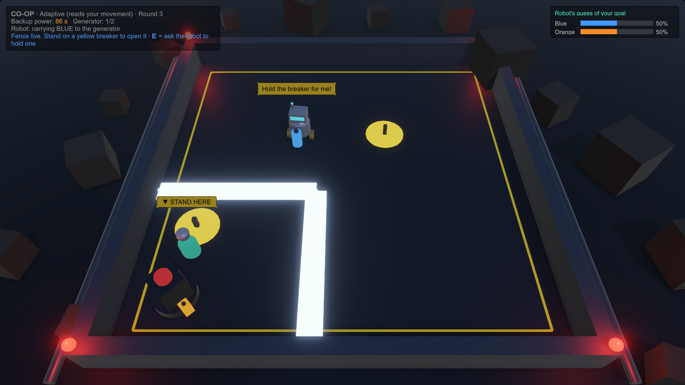
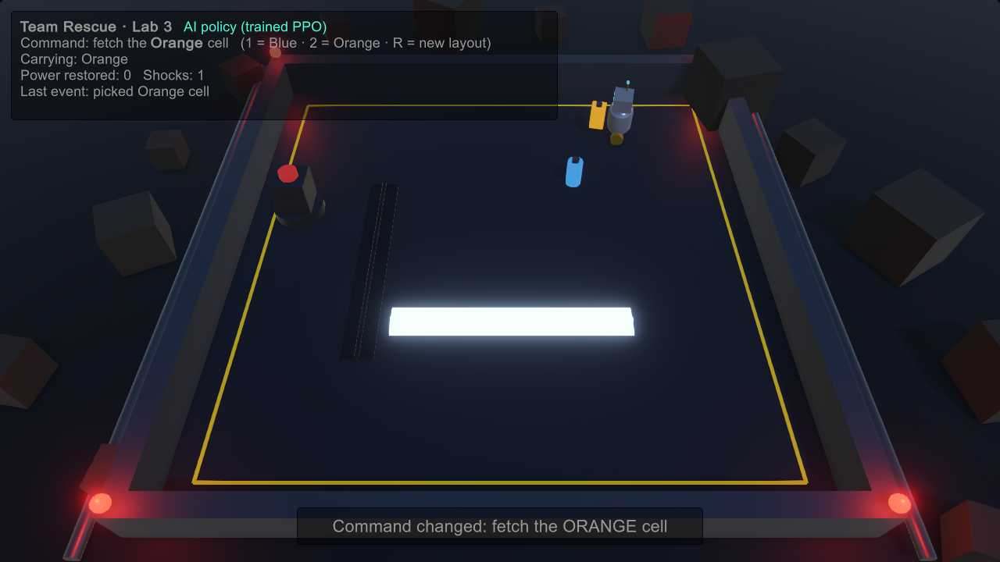

# Team Rescue: a human–AI rescue robot in Unity ML-Agents

A Unity 6 game in which a **reinforcement-learning robot** (PPO, Unity ML-Agents 4.1) restores power in a blacked-out station: it must fetch the power cell that a human asks for and avoid exposed cables that switch on and off. On top of the learned policy there are two interaction layers:

1. **Natural-language orders.** A local LLM (Qwen2.5-3B through Ollama, no cloud, CPU only) turns Chinese, English or French sentences into a structured goal. Ordinary code then resolves that goal against the scene.
2. **Human–AI teamwork.** The generator stands in a corner room sealed by a fence that is always live. Only someone standing on a breaker (one outside the room, one inside) switches it off, so the player and the robot have to open the fence for each other: nobody can finish alone. The robot asks for help in a speech bubble when it is stuck; the player presses E (or types "hold the breaker") to ask the robot. An adaptive teammate infers which cell the player is heading for, takes the other one, and walks to a breaker by itself when it sees the player carrying a cell towards the fence.



Built for Lab 3 of an HCI course ("a Unity application using an ML agent"). The full process journal, including every failed training run and how it was fixed, is on the blog: [English](https://icey000.github.io/coursework/hci/lab-ml-agent/) · [中文](https://icey000.github.io/zh/coursework/hci/lab-ml-agent/).



## How the pieces fit

```
 typed order ──► local LLM (parse only) ──► {intent, refs[{by, negated}]} ──► grounding code ──► target cell
                                                                                                │
 player movement ──► goal inference (adaptive teammate) ─────────────────────────────────────────┤
                                                                                                ▼
                                       PPO policy (ONNX, runs in Unity) ◄── 25 observations: target one-hot,
                                                 │                          cell/generator positions, cable state
                                                 ▼
                                       continuous movement (2 actions)
```

The language model **never controls the robot**. It only translates words into a goal (which cell, or stop/cancel). The movement, cable avoidance and pick-up/delivery are done by the trained neural network, which knows nothing about language. A weaker or stronger LLM therefore changes how well orders are *understood*, not how well the robot *moves*.

## Results

| What was measured | Result |
|---|---|
| Learned policy vs. scripted straight-line baseline, 300 random layouts, 2 cables | Same success rate (97.3 % vs 97.3 %), **78 % fewer shocks** (0.33 vs 1.51 per episode), about 1.9 s slower per delivery |
| Language layer, 20 held-out commands evaluated once | **85 %** correct with Qwen2.5-3B + grounding vs **55 %** for keyword rules; about 5.8 s per command on a laptop CPU; fails on ambiguous orders that need a clarifying question |
| Co-op behind the fence, 150 rounds per mode against a simulated partner | Completion 100 % in both. Adaptive vs fixed plan: **6.4 s vs 8.3 s per round** (difference 1.9 s, 95 % CI 1.7–2.1), the partner waits **0.36 s vs 2.33 s** at the live fence and never has to ask for the breaker (0 vs 0.9 requests per round); same-cell conflicts 2.0 % vs 50.0 %. In both modes each side opens the fence for the other about once per round. |

The co-op numbers come from a *simulated* partner. A within-subjects user study (practice + 3 conditions × 3 rounds, Latin-square order, 7-item questionnaire including "was it fun") is prepared in [`study/`](study/) and has **not been run yet**.

How the co-op version got here: the first version only shared the work, and my own play-test showed it felt like a race next to the robot, plus a freeze bug. The fenced version makes the two players depend on each other. Getting it to work exposed three limits of the trained policy, each handled by scripting rather than retraining: it hovers about 1 m from any goal instead of stopping on it (so stepping onto a breaker is scripted), it keeps a safe distance from a cable that never switches off (so walking up to the fence is scripted), and it does not reliably cross even when the fence goes dark (so the crossing itself is scripted). Fetching and delivering cells remain the trained network's job.

## Repository layout

| Path | Contents |
|---|---|
| `UnityProject/Assets/Scripts/` | Agent (`RescueBotAgent.cs`), arena, cables, shock feedback, demo HUD and evaluation modes |
| `UnityProject/Assets/Scripts/Language/` | LLM client (`OllamaParser.cs`), keyword baseline, grounding, chat UI |
| `UnityProject/Assets/Scripts/Coop/` | Player avatar, simulated partner, co-op coordinator with goal inference and study logging |
| `UnityProject/Assets/Editor/ArenaBuilder.cs` | Generates all scenes and builds every player from the command line |
| `UnityProject/Assets/TeamRescue/Models/` | Trained policies (`RescueBot_v3ft.onnx` is the final one) |
| `UnityProject/Assets/StreamingAssets/command_prompt.txt` | The LLM prompt |
| `training/` | ML-Agents configs: curriculum PPO run (4 M steps) and fine-tune (2 M steps) |
| `language/` | 45 development commands and 20 held-out commands |
| `results/` | Evaluation JSON/CSV, training curves, screenshots |
| `study/` | User-study protocol, questionnaire, launcher and analysis script |
| `tools/` | Scalar export, plotting and simulation analysis scripts |

## Running it

Requirements: Windows, Unity 6000.6.4f1, and optionally [Ollama](https://ollama.com) with `qwen2.5:3b` for typed orders (`ollama pull qwen2.5:3b`, about 2 GB, runs on CPU). Without Ollama the game falls back to keyword rules.

Build the players (Unity Hub must be running for the licence):

```bat
set TEAMRESCUE_MODEL=Assets/TeamRescue/Models/RescueBot_v3ft.onnx
Unity.exe -batchmode -quit -projectPath UnityProject -executeMethod TeamRescue.EditorTools.ArenaBuilder.BatchBuildDemoPlayer
Unity.exe -batchmode -quit -projectPath UnityProject -executeMethod TeamRescue.EditorTools.ArenaBuilder.BatchBuildCoopPlayer
```

Then run `Play-TeamRescue.cmd` (robot follows your orders) or `Play-Coop.cmd` (play together; F1 fixed plan, F2 adaptive, F3 typed orders, WASD to move, stand on a yellow breaker to switch the fence off, E to ask the robot to hold one).

Retraining (Python 3.10, `mlagents==1.1.0`, CPU is enough; about 2 k steps/s with 4 parallel environments):

```bat
mlagents-learn training/rescuebot_ppo.yaml --run-id=rescuebot_v3 --env=Build/Train/TeamRescueTrain.exe --num-envs=4 --no-graphics
```

Evaluation flags of the demo player: `-eval N out.json [-baseline]`. The co-op player has `-coopsim N out.csv -mode fixed|adaptive [-trace trace.csv]`, and `python tools/analyze_fence.py` summarises the fenced co-op runs (`tools/analyze_sim.py` the earlier open-arena version).

## Known limitations

- The robot does not yield to the player's body: its sensors were trained without a human in the arena.
- In the co-op version, approaching the fence, crossing it and stepping onto a breaker are scripted; a policy trained with a partner and a fence would be the cleaner solution.
- The 3B model takes about 4–7 s per order on CPU and cannot yet ask a clarifying question when an order is ambiguous.
- One training seed; the simulated partner is not a substitute for real participants.
